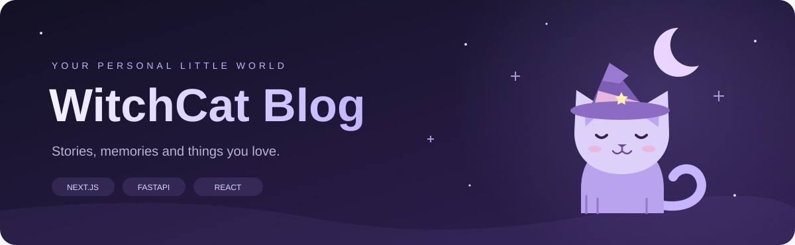

<div align="center">



**写下日常，收藏喜欢的世界。**

一个包含博客前台、管理后台与 API 的个人站点项目，
把文章、日记、相册、音乐、游戏与追番收在一起。


[功能](#功能) · [快速开始](#快速开始) · [个性化](#个性化与占位配置) · [项目结构](#项目结构) · [许可](#许可与素材)

</div>

## 功能

| 写作与记录 | 兴趣与展示 | 管理与服务 |
| :--- | :--- | :--- |
| 📝 Markdown 文章、归档与 RSS | 🎵 音乐播放与网易云 API 集成 | 🛠️ 独立管理后台、站点配置 |
| 📔 日记、时间线与相册 | 🎮 Steam 游戏展示、追番清单 | 🔐 用户权限、访问与刷新令牌 |
| 🌗 暗色模式、主题切换 | 🐾 Live2D 看板娘 | 📊 访客统计、日志、定时任务 |
| 🌐 中文 / English | 🔗 友链、资源与项目展示 | 🤖 可配置 AI 服务、对象存储 |

音乐、Steam、AI 等集成需要自行配置对应服务或 API 凭据。仓库不包含线上文章、用户数据库、上传内容或生产环境配置。

## 项目结构

```text
witchBlog/
├── web/                  # Next.js 博客前台
│   ├── src/config/       # 公开站点占位配置
│   └── public/           # 静态资源与 Live2D 模型
├── admin/                # React + Vite 管理后台
├── backend/              # FastAPI 服务
│   ├── app/              # API、业务服务与数据模型
│   ├── alembic/          # 数据库迁移
│   ├── scripts/          # 检查与维护脚本
│   └── docs/             # API、部署与开发文档
├── docs/assets/          # README 图形
├── LICENSE               # 非商业 · 必须署名 · 源码共享
└── THIRD_PARTY_NOTICES.md # 第三方依赖与素材边界
```

| 子项目 | 技术栈 | 本地地址 |
| --- | --- | --- |
| [博客前台](./web/) | Next.js 15 · React 19 · TypeScript · Tailwind CSS · next-intl | `http://localhost:3001`（按下方命令） |
| [管理后台](./admin/) | React 19 · TypeScript · Vite | `http://localhost:5173` |
| [后端 API](./backend/) | Python · FastAPI · SQLAlchemy · MySQL · Redis · MinIO | `http://localhost:8000` |

## 快速开始

建议使用 **Python 3.11**、**Node.js 22.12+** 与 npm。后端需准备自己的 MySQL 数据库；Redis 和 MinIO 用于缓存、任务及文件存储。三个服务分别在独立终端运行。

### 1 · 获取项目

```bash
git clone https://github.com/witchscottishfoldcat/witchBlog.git
cd witchBlog
```

### 2 · 配置并启动 API

Windows PowerShell：

```powershell
cd backend
py -3.11 -m venv .venv
.\.venv\Scripts\Activate.ps1
$env:PYTHONUTF8 = "1"
python -m pip install -r requirements.txt
Copy-Item .env.example .env
```

Linux / macOS：

```bash
cd backend
python3.11 -m venv .venv
source .venv/bin/activate
python -m pip install -r requirements.txt
cp .env.example .env
```

**先编辑 `.env`，再初始化数据库：**

| 配置 | 本地开发设置 |
| --- | --- |
| `ENVIRONMENT` | `development` |
| `SECRET_KEY` | 自行生成的随机密钥，不能使用模板值 |
| `DATABASE_URL` 与 `MYSQL_*` | 自己的数据库地址、账号、密码与库名 |
| `BACKEND_CORS_ORIGINS` | `["http://localhost:3001","http://localhost:5173"]` |
| `REDIS_URL`、`MINIO_*` | 自己的服务地址与访问凭据 |

```bash
python scripts/maintenance/init_db.py --username your-admin-user --email admin@example.com
# 按提示输入并确认密码，没有默认密码
python main.py
```

交互式 API 文档：`http://localhost:8000/docs`。已有数据库请参照 [迁移与部署文档](./backend/docs/) 管理结构，不要用初始化脚本替代迁移流程。

### 3 · 启动博客前台

```bash
cd web
npm ci
# 将 .env.local.example 复制为 .env.local，填写 API 与站点地址
npm run dev -- --port 3001
```

`.env.local` 中设置 `NEXT_PUBLIC_API_URL=http://127.0.0.1:8000`，本地 `NEXT_PUBLIC_SITE_URL=http://localhost:3001`。首次启动会生成 Contentlayer 类型与内容索引。

### 4 · 启动管理后台

```bash
cd admin
npm ci
npm run dev
```

默认通过 Vite 代理访问本机 API；也可设置 `VITE_API_BASE_URL`。使用第 2 步创建的管理员账号登录。

<details>
<summary><strong>可选服务：音乐、Steam、AI 与 IP 归属地</strong></summary>

- 音乐：自行部署兼容的网易云音乐 API，设置 `NETEASE_API_BASE`。
- Steam：设置自己的 `STEAM_API_KEY` 和 `STEAM_DEFAULT_USER_ID`。
- AI：按需填写后端模板中的服务地址、模型与 API Key。
- 访客归属地：自行获取 `qqwry.dat` 并放入 `backend/data/`；文件不随仓库分发，缺失时相关功能降级。

</details>

## 个性化与占位配置

公开版本使用示例信息。部署前请填写自己的公开资料与配置。

| 要修改的内容 | 位置 / 方式 |
| --- | --- |
| 公开署名、社交链接、备案号 | [`web/src/config/public-site.ts`](./web/src/config/public-site.ts) |
| 站点域名、API 与图片代理主机 | [`web/.env.local.example`](./web/.env.local.example)，复制后编辑 |
| 数据库、对象存储、密钥与第三方 API | [`backend/.env.example`](./backend/.env.example)，复制后编辑 |
| 收款信息 | 收款页使用不可扫码的 [`payment-placeholder.svg`](./web/public/assets/support/payment-placeholder.svg)；按需换成自己的素材 |
| Steam 账号连通性测试 | 设置 `STEAM_DEFAULT_USER_ID`、`STEAM_VANITY_NAME`；未设置则跳过账号查询 |
| 手动日志 / 照片测试 | 设置 `TEST_ADMIN_USERNAME`、`TEST_ADMIN_PASSWORD` |
| 批量导入文章 | `python scripts/maintenance/upload_new_posts.py --posts-dir ./new-posts --owner-id YOUR_USER_ID` |

真实 `.env`、密钥、数据库、上传文件、日志和依赖目录已配置忽略。部署自己的修改版时，保留 WitchCat 项目署名，并将 `public-site.ts` 中的 `sourceUrl` 指向对应版本的公开源码。

## 构建与部署

```bash
# web/
npm run build
npm run start -- --port 3001

# admin/
npm run build
```

各子项目提供 Dockerfile；后端与前台还提供 Docker Compose 配置。配置文件、Jenkinsfile 与部署脚本作为自建环境的参考，部署前填写自己的域名、服务连接、CORS 与凭据。生产环境使用独立强密钥；前后台缓存刷新密钥必须一致。

开发与 API 说明见 [后端文档](./backend/docs/)、[前台文档](./web/README.md) 和 [管理后台](./admin/)。

发布前的依赖扫描仍报告上游安全公告，详见 [依赖检查记录](./docs/dependency-status.md)。部署到公网前应完成相关依赖更新与运行环境验证。

## 许可与素材

项目原创代码与文档采用 **[WitchCat 非商业署名源码共享许可 1.0](./LICENSE)**：

- **不可商用**：商业产品、收费服务、商业运营与广告或赞助变现等需另行取得许可。
- **必须署名**：保留版权、许可、原项目链接与修改说明；部署界面保留 WitchCat 署名。
- **必须共享源码**：分发或向他人提供网络服务时，免费公开对应完整源码，修改版沿用同一许可。

这是带非商业限制的**源码公开许可**，不属于 OSI 定义的开放源代码许可。以上为简要说明，完整英文 [LICENSE](./LICENSE) 为准。

第三方音乐、插画、Live2D 模型与运行时保留原作者权利，遵循各自原许可；本项目许可不授予这些素材的再分发权。详见 [THIRD_PARTY_NOTICES.md](./THIRD_PARTY_NOTICES.md)。

## 参与贡献

欢迎通过 [Issues](https://github.com/witchscottishfoldcat/witchBlog/issues) 报告问题，通过 Pull Request 提交改进。请说明复现步骤或变更效果，保持改动聚焦，并确保贡献的代码与素材具备相应权利。提交贡献即表示按项目许可提供该贡献。

<div align="center">

<sub>WitchCat Blog · A little corner for stories, memories and things you love.</sub>

</div>
