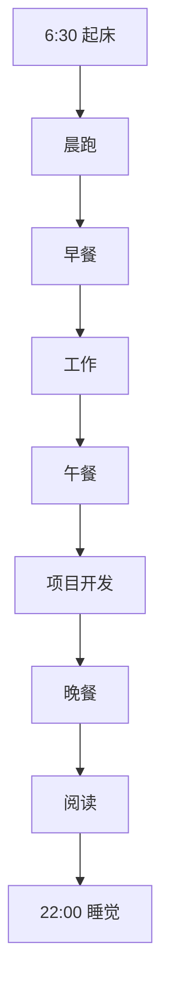

# 丰富多彩的一天

> "生活就像一盒巧克力，你永远不知道下一颗是什么味道。" —— 《阿甘正传》

今天是我人生中非常特别的一天，有很多值得记录的时刻。

## 🌅 清晨 - 新的开始

早上6点30分，我被窗外的鸟鸣声唤醒。拉开窗帘，看到晨光中的城市轮廓，整个世界仿佛刚刚苏醒。我做了一个简单的早餐：

- 烤面包片 🍞
- 煎蛋 🍳
- 新鲜的橙汁 🥤
- 一杯香浓的咖啡 ☕

> *早晨的阳光是最好的闹钟，也是最好的心情调节剂。*

## 🏃‍♂️ 上午 - 运动与工作

### 晨跑

7点30分，我开始晨跑。今天我跑了5公里，配速5分30秒/公里，感觉状态很好！跑步路线图如下：

```
起点 → 公园入口 → 环湖跑道 → 森林小径 → 公园出口 → 终点
```

### 工作时间

9点到12点，我在家处理了一些工作项目。今天完成了以下任务：

| 任务名称 | 完成度 | 耗时 |
|---------|--------|------|
| 项目文档编写 | 100% | 1.5小时 |
| 代码审查 | 100% | 1小时 |
| 团队会议 | 100% | 0.5小时 |

## 🍽️ 中午 - 美食与休息

午餐是今天的亮点之一！我尝试了新发现的餐馆，点了他们的招牌菜：

1. **麻辣香锅** - 辣度适中，配菜丰富
2. **清蒸鲈鱼** - 鲜嫩多汁，调味恰到好处
3. **蒜蓉青菜** - 清爽解腻，绿色健康

<div style="background-color: #f5f5f5; padding: 10px; border-left: 4px solid #4CAF50;">
    <strong>小贴士：</strong> 这家餐馆位于市中心商业街，环境优雅，服务周到。推荐指数：⭐⭐⭐⭐⭐
</div>

## 🌸 下午 - 自然之美

下午我去了植物园，欣赏春天的花卉展览。这里有一些美丽的照片（如果API支持图片上传）：

```
[此处应该有樱花照片]
[此处应该有郁金香照片]
[此处应该有牡丹照片]
```

植物园的花语墙很有趣：

- **樱花**：生命的美好与短暂
- **郁金香**：爱的告白与永恒
- **牡丹**：富贵与吉祥
- **玫瑰**：爱情与热情

## 📚 晚间 - 学习与反思

### 读书时光

晚上我读了一本很有趣的书，《原子习惯》。书中的一些观点让我印象深刻：

> "微小改变带来巨大成果。每天进步1%，一年后你将进步37倍。"

我决定尝试这个方法，制定以下微小习惯：

1. 每天早起10分钟
2. 每天运动15分钟
3. 每天读书5页
4. 每天写作100字
5. 每天冥想3分钟

### 今日反思

今天整体来说是非常充实和快乐的一天。我学到了：

- 早起可以带来更多有效时间
- 运动后工作效率更高
- 美食能够提升幸福感
- 自然是最好的疗愈师
- 阅读是成长的催化剂

## 🎯 明日计划

为了保持这种积极的状态，我为明天做了简单计划：



---

## 📝 今日小结

- **心情指数**：😊😊😊😊😊 (5/5)
- **天气状况**：☀️ 晴朗，微风
- **完成事项**：8/10
- **收获**：新知识、好心情、健康饮食
- **改进空间**：时间管理、专注度

---

**标签**: #生活记录 #成长 #正能量 #美好时光 #日记

*最后更新时间：2023年12月9日*